# Auditoría cruzada

**Sistema:** C

## 1. Datos de la auditoría

| Campo | Valor |
| --- | --- |
| Equipo auditor | Kairós Tech |
| Equipo auditado | 8bit |
| Sistema | Barkvision - SIstema de analisis de imgenes forestales |
| Fecha | 14/10/2026 |
| Ambiente autorizado | https://barkvision-front-qa-23388530788.southamerica-west1.run.app/ |
| Versión / commit | 1.0.0 |
| Navegador y dispositivo | Chrome |
| Alcance | Crear análisis, gestión de empresas, usuarios y procesar imágenes. |
| Fuera de alcance | android |

## 2. Resumen ejecutivo

**Objetivo:** Usabilidad

**Resultado general:** Se realizó un testeo exploratorio de las funcionalidades implementadas.

| Severidad | Cantidad |
| --- | --- |
| Crítica | 0 |
| Alta | 0 |
| Media | 0 |
| Baja | 1 |
| Total | 1 |

## 3. Criterios de severidad

| Severidad | Criterio |
| --- | --- |
| Crítica | Compromete la seguridad o la integridad de los datos, o impide usar el sistema. |
| Alta | Afecta una funcionalidad principal o genera resultados incorrectos. |
| Media | Dificulta el uso o confunde al usuario, pero existe una alternativa. |
| Baja | Detalle visual, de redacción o de accesibilidad menor. |

## 4. Funcionalidades revisadas

Marcar lo que efectivamente se probó.

- Login
- Crear un análisis de Gravillas
- Procesar las imágenes de un análisis
- Aceptar resultados
- Gestión de empresa
- Gestión de usuarios

**Flujo revisado:**

### 4.1. Login

Se accedió a la aplicación en forma exitosa con las credenciales aportadas por el equipo 8bit para la instancia presencial.

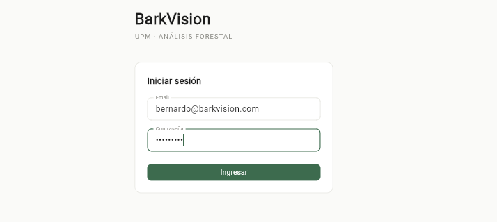

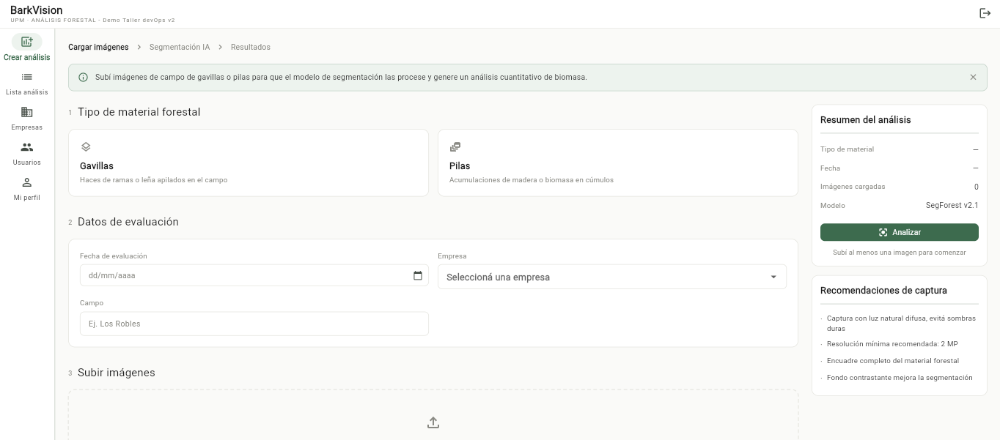

### 4.2. Crear un análisis de gavilla

En la pantalla principal, y se llenan los siguientes campo: se selecciona como tipo de material forestal “Gavillas”; se establece la fecha; se selecciona la empresa desde lista desplegable, se escribe el número de máquina Harvester; se escribe el nombre del campo, y se sube una fotografía de gavillas aportada por el equipo 8bit. Finalmente, se presiona el botón “Analizar”.

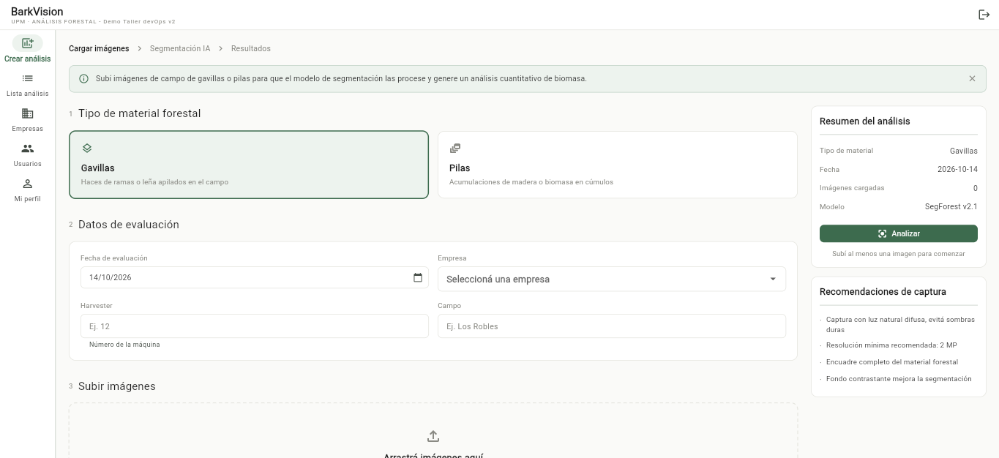

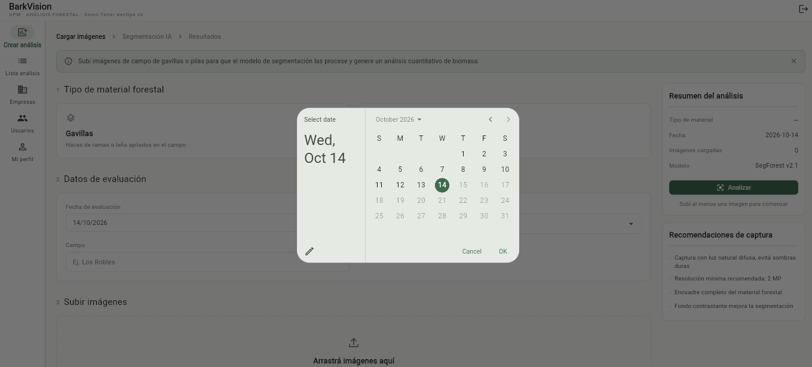

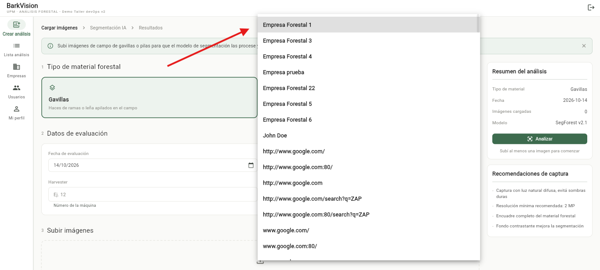

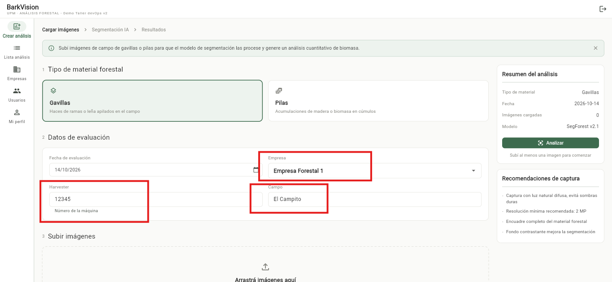

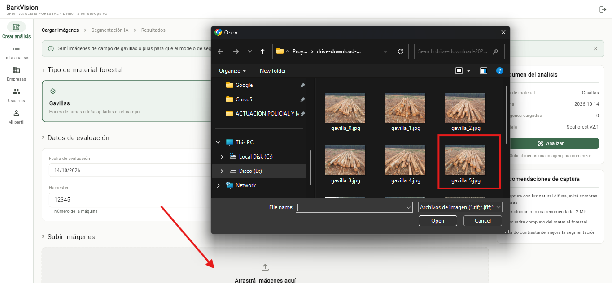

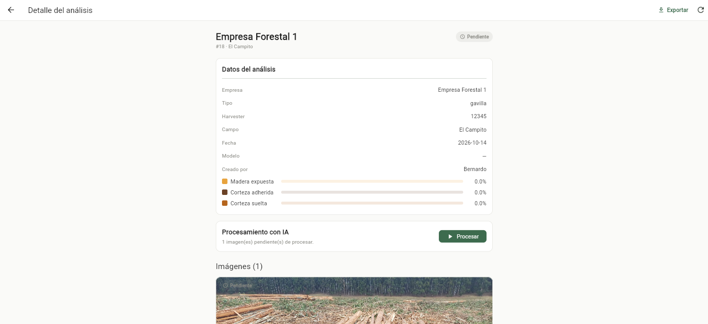

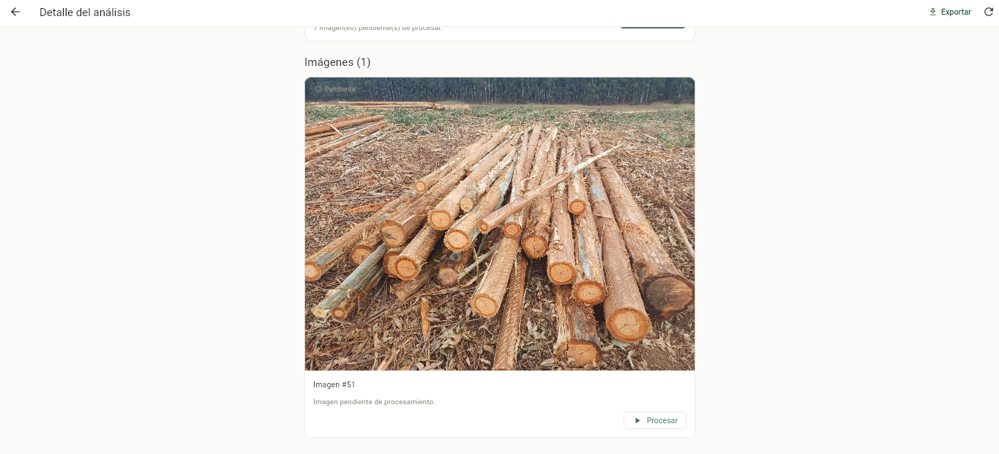

### 4.3. Procesar la imagen de un análisis y aceptar resultados

Se presiona el botón “Procesar”, y una vez procesada la imagen se presiona “Aceptar”.

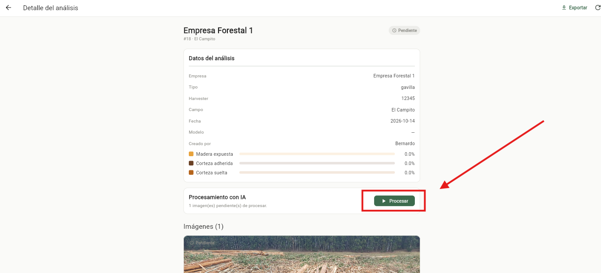

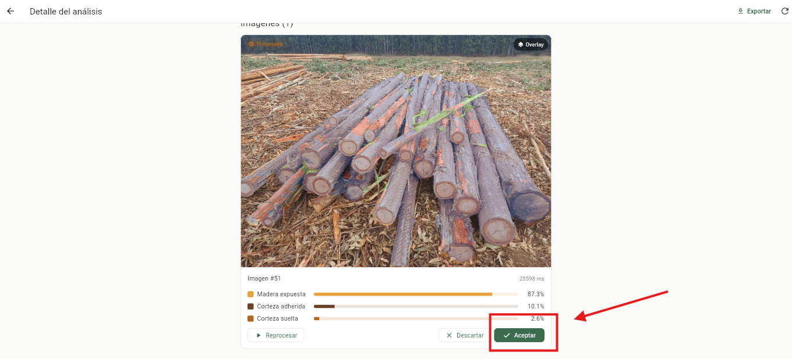

### 4.4. Gestión de empresa

Se selecciona el ícono “Empresas”, se presiona el botón “Nueva empresa”, se carga como nombre de la nueva empresa “Empresa Instancia Presencial” y se presiona “Guardar” y finalmente se confirma que se haya registrado.

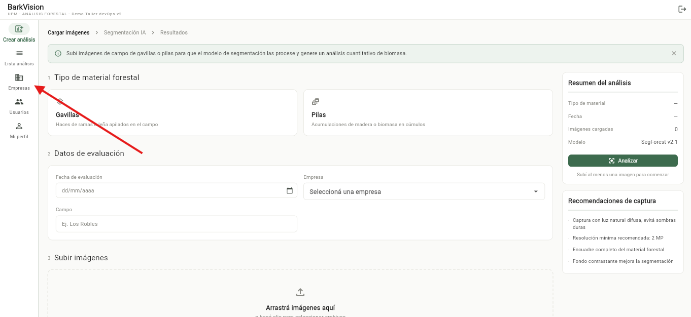

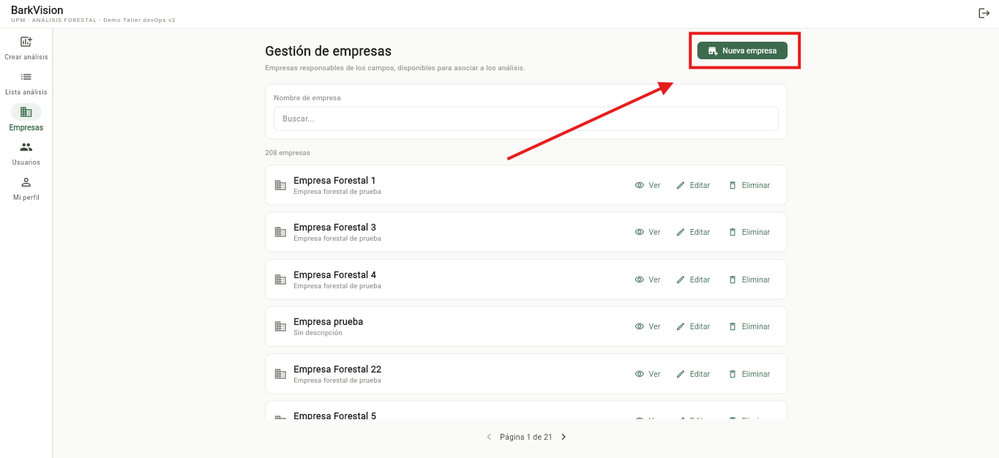

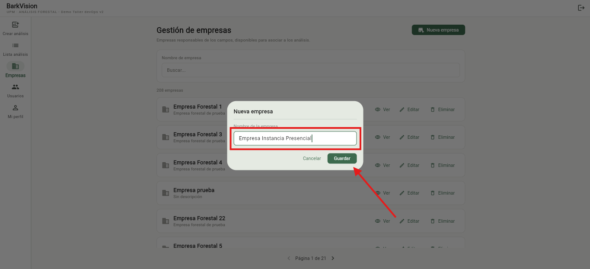

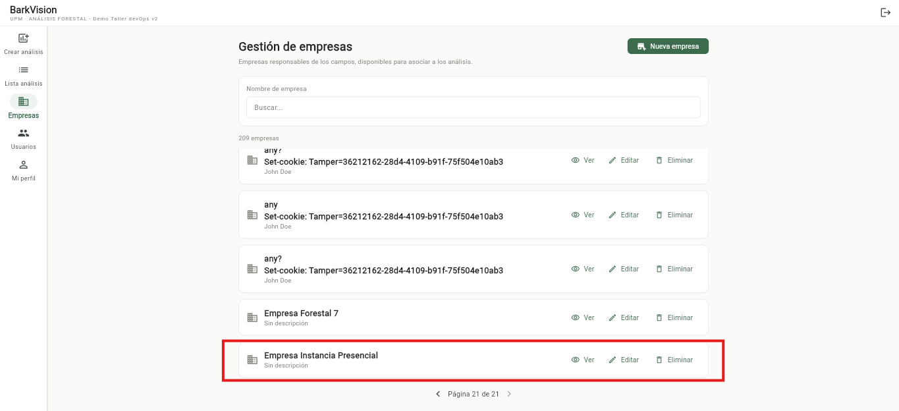

### 4.5. Gestión de usuarios

Se selecciona el ícono “Usuarios”, se presiona el botón “Nuevo usuario”, se carga los datos del nuevo usuario y se presiona “Guardar” y finalmente se confirma que se haya registrado.

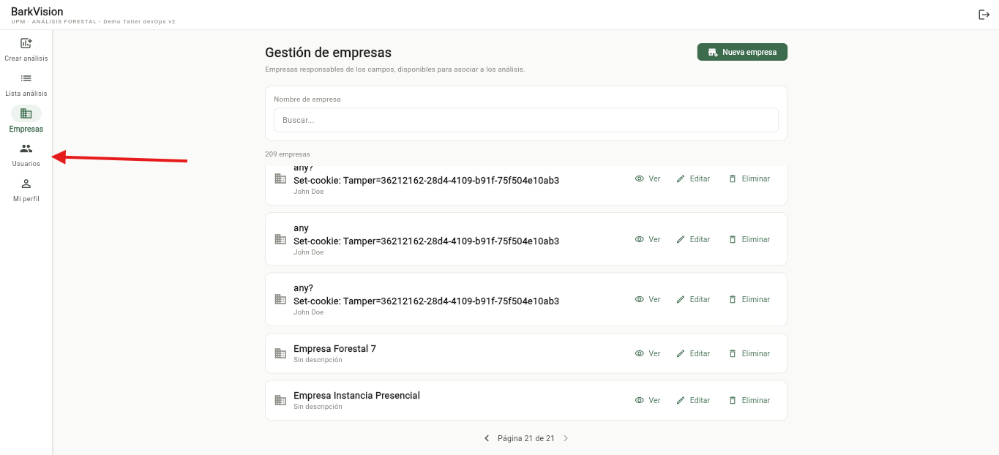

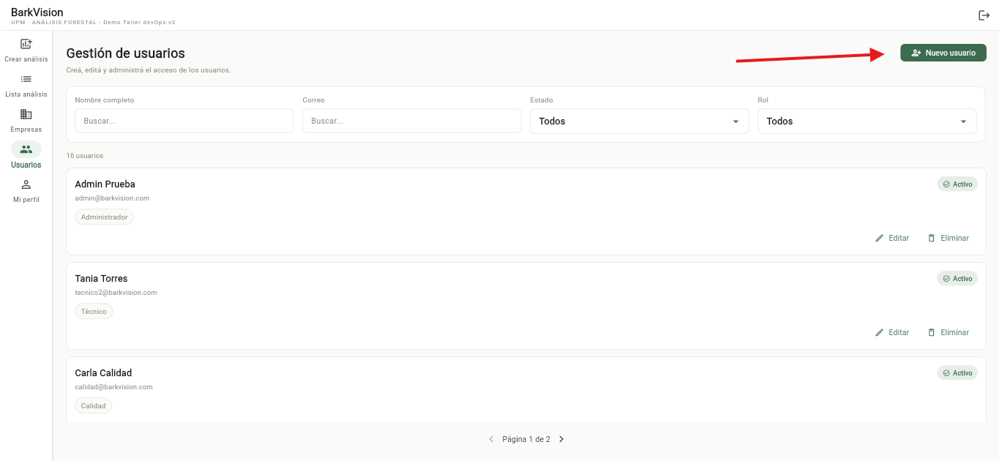

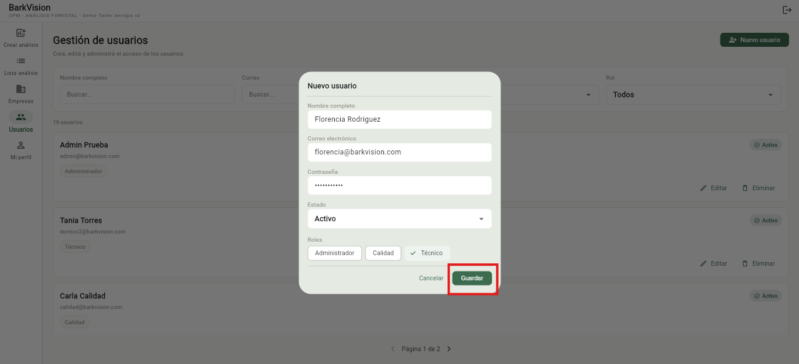

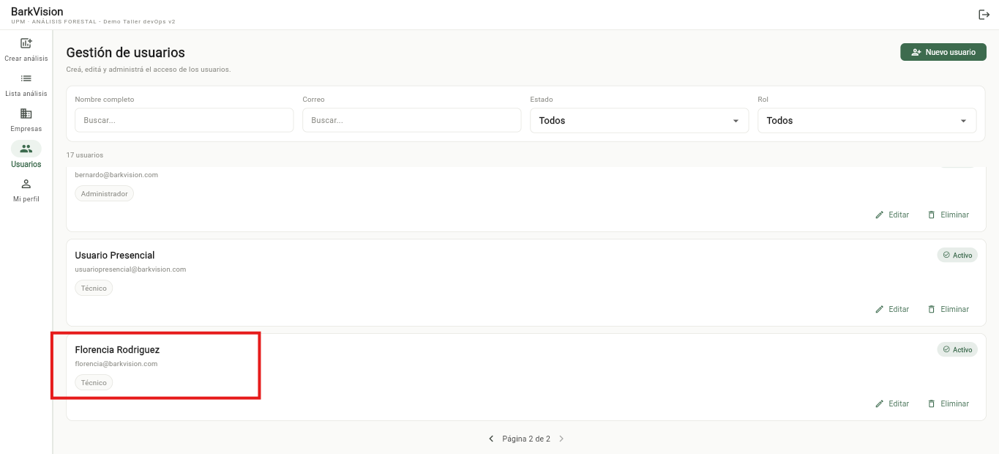

## 5. Hallazgos

Copiar y pegar un bloque por cada hallazgo (H-01, H-02, H-03…).

### H-01 - No se visualiza el archivo cargado al subir una imagen en Crear un análisis de gavilla

| Campo | Detalle |
| --- | --- |
| Categoría | UX |
| Severidad | Baja |
| Estado | Confirmado |
| Descripción | Cuando se selecciona la imagen, no se visualiza en pantalla que esa imagen esté cargada, cuando realmente lo está. |
| Precondiciones | El usuario se logueó correctamente en la aplicación y se encuentra en la página de Crear análisis. |

**Pasos para reproducir:**

1. Seleccionar tipo de material: Gavillas.
2. Completar datos: fecha de evaluación; empresa; harvester y nombre de campo.
3. Cargar imagen.

**Resultado esperado:** Debería verse que existe un archivo cargado en el “drag and drop”.

**Resultado obtenido:** No se visualiza el archivo cargado aunque realmente sí lo está, según fue verificado en el 4.2. Crear un análisis de gavilla y 4.3. Procesar la imagen de un análisis y aceptar resultados.

**Evidencia:**

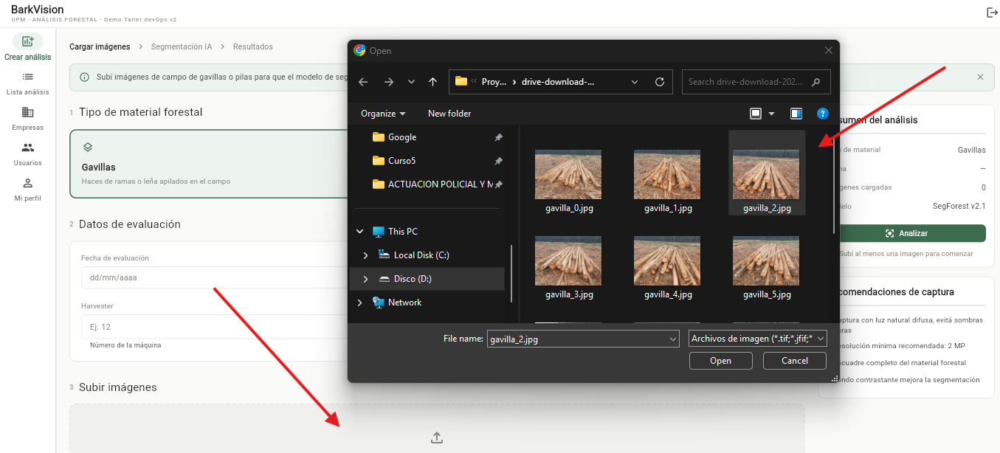

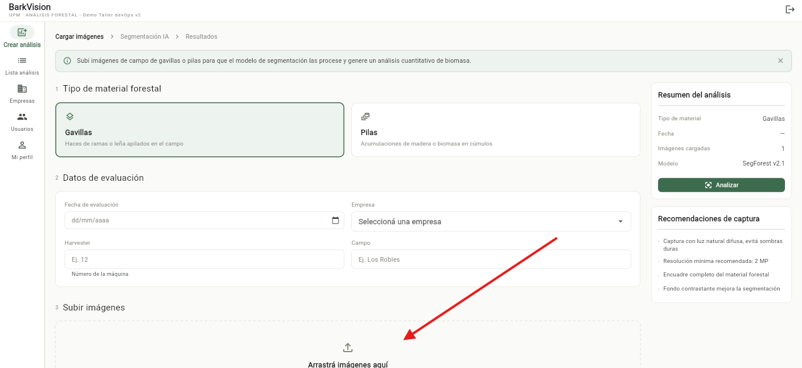

**Recomendación:** Se sugiere que se pueda ver el archivo cargado al “drag and drop”.

## 6. Matriz consolidada

| ID | Categoría | Hallazgo o prueba | Severidad | Estado | Evidencia |
| --- | --- | --- | --- | --- | --- |
| H-01 | UX | No se visualiza el archivo cargado al subir una imagen en Crear un análisis de gavilla | Baja | Confirmado | Ver imágenes |

## 7. Escenarios técnicos ejecutados

Se realizaron pruebas exploratorias funcionales y de usabilidad sobre Barkvision, versión 1.0.0, utilizando Chrome en el ambiente QA autorizado durante la instancia presencial del 14/10/2026. Los escenarios ejecutados y sus resultados se detallan a continuación.

| Escenario | Resultado esperado | Resultado obtenido | Evidencia |
| --- | --- | --- | --- |
| Inicio de sesión con credenciales proporcionadas por el equipo auditado. | Permitir el acceso a la aplicación con credenciales válidas. | Se accedió correctamente a la aplicación. | Capturas de la sección 4.1. Login. |
| Creación de un análisis de gavillas: completar los datos requeridos, seleccionar una fotografía y presionar “Analizar”. | Permitir iniciar el análisis con los datos ingresados y mostrar que existe una imagen seleccionada. | Se pudo continuar con el flujo de análisis. Sin embargo, el componente de carga no mostró visualmente el archivo seleccionado, aunque la imagen quedó disponible para su procesamiento. Se registró el hallazgo H-01. | Capturas de la sección 4.2 y evidencias de H-01. |
| Procesamiento de la imagen y aceptación de resultados. | Permitir procesar la imagen cargada y aceptar los resultados presentados. | Se ejecutó el procesamiento y posteriormente se presionó “Aceptar”, sin registrarse otro hallazgo en este paso. | Capturas de la sección 4.3. |
| Registro de una nueva empresa. | Permitir guardar una empresa con los datos ingresados y comprobar su registro. | Se creó la empresa de prueba “Empresa Instancia Presencial” y se confirmó su registro. | Capturas de la sección 4.4. Gestión de empresas. |
| Registro de un nuevo usuario. | Permitir guardar un usuario con los datos ingresados y comprobar su registro. | Se ingresaron los datos del nuevo usuario, se presionó “Guardar” y se confirmó su registro. | Capturas de la sección 4.5. Gestión de usuarios. |

## 8. Recomendaciones priorizadas

| Prioridad | Recomendación | Hallazgo | Responsable | Criterio de aceptación |
| --- | --- | --- | --- | --- |
| Baja | Corregir el componente de carga de imágenes para que muestre claramente el archivo seleccionado, mediante su nombre y/o una vista previa, antes de iniciar el análisis. | H-01 - No se visualiza el archivo cargado al subir una imagen en “Crear un análisis de gavilla”. | Equipo 8bit: responsable de frontend/UX. | Al seleccionar una imagen válida, el componente muestra el nombre del archivo y/o una vista previa antes de presionar “Analizar”. La imagen continúa disponible para el procesamiento. Se repiten los pasos de H-01 y el flujo de procesamiento y aceptación, registrando evidencia de la corrección y del resultado de la prueba. |

## 9. Validación con el equipo auditado

| Hallazgo | ¿Se pudo reproducir? | Respuesta del equipo | Acción acordada |
| --- | --- | --- | --- |
| H-01 | Sí, por el equipo auditor durante la ejecución documentada. Reproducción conjunta con 8bit: pendiente de documentar. | El equipo ya tenía conocimiento. | El equipo revisará y corregirá el hallazgo. |

## 10. Conclusiones

La auditoría exploratoria permitió completar los flujos revisados de Barkvision e identificar un único hallazgo de usabilidad, de severidad baja, aunque esta puede procesarse correctamente. Los resultados se limitan al ambiente QA y a los escenarios ejecutados.

## Checklist de entrega

- Capturas reales y anonimizadas guardadas en la carpeta evidencias
- Informe y evidencias subidos al repositorio GitLab del equipo auditor
- Publicado en el foro de UTEC: equipo auditor, equipo auditado y enlace al informe
- Enlace accesible para docentes e imágenes visibles
- Sin datos sensibles (credenciales, tokens, datos personales, información confidencial)
